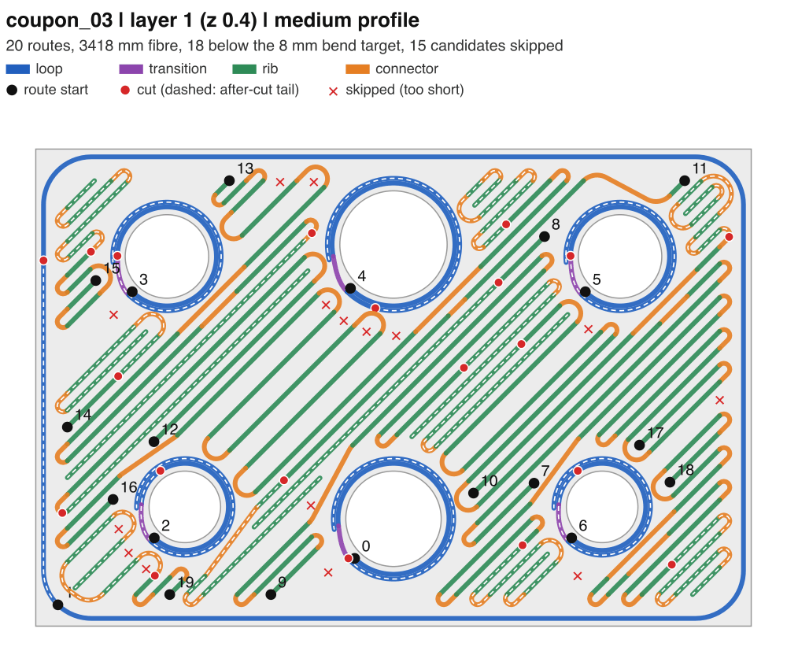
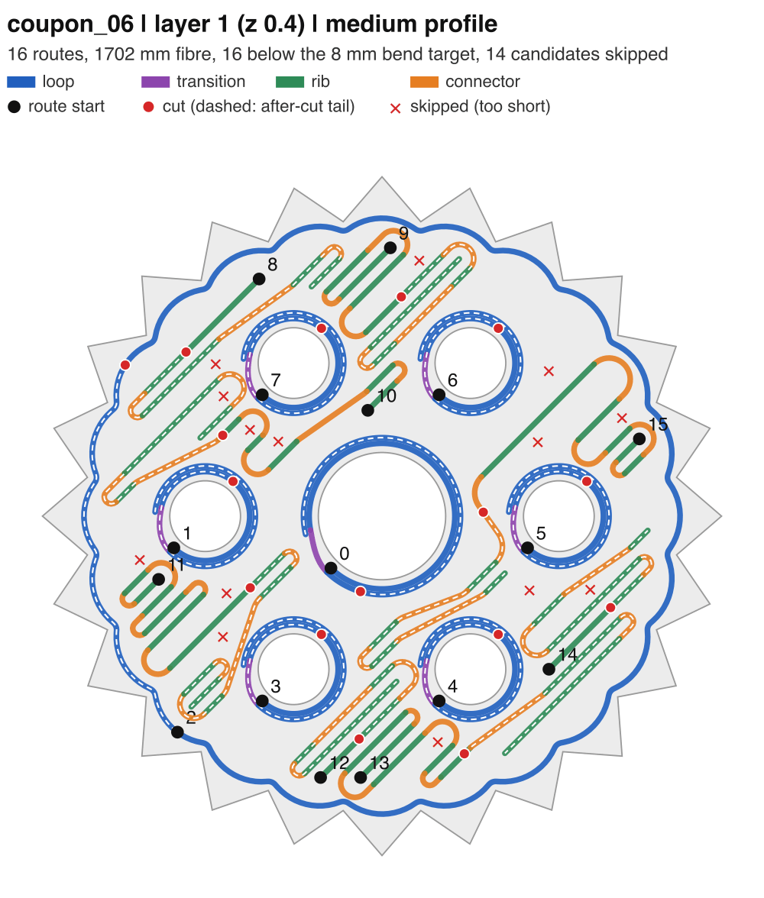
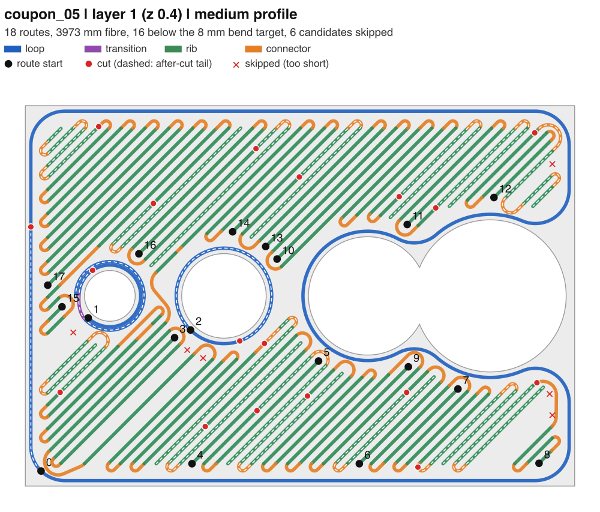
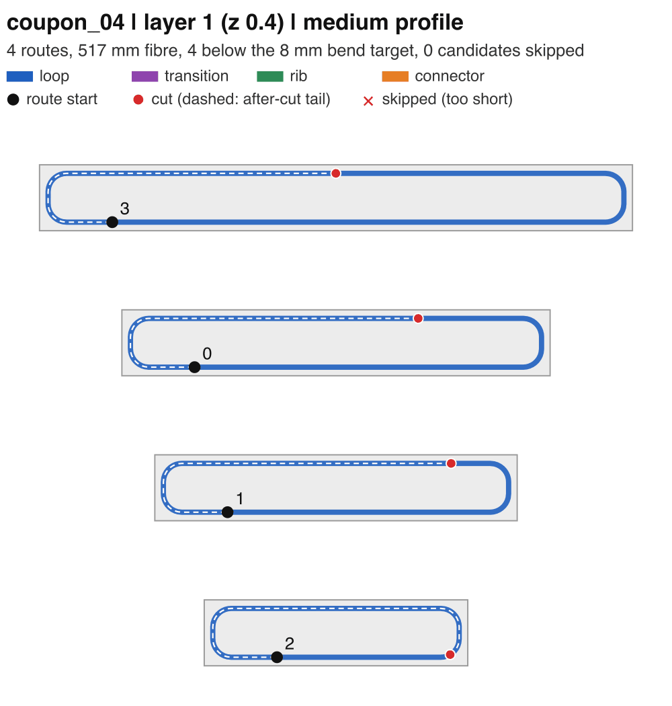
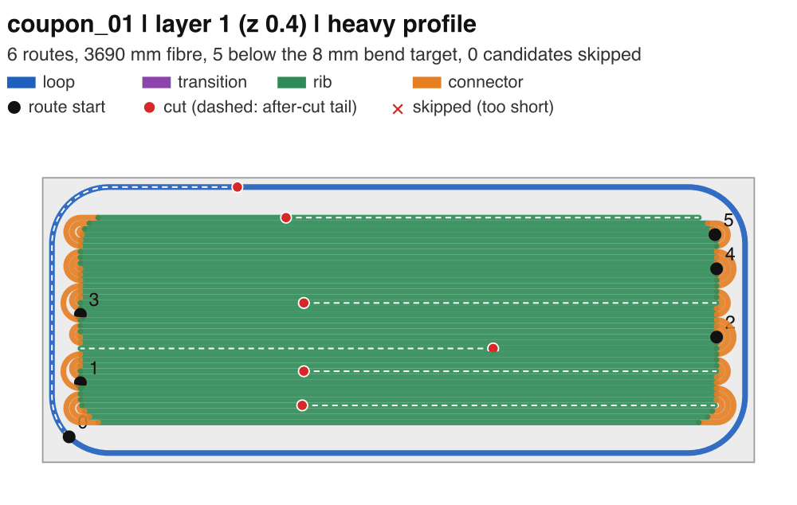
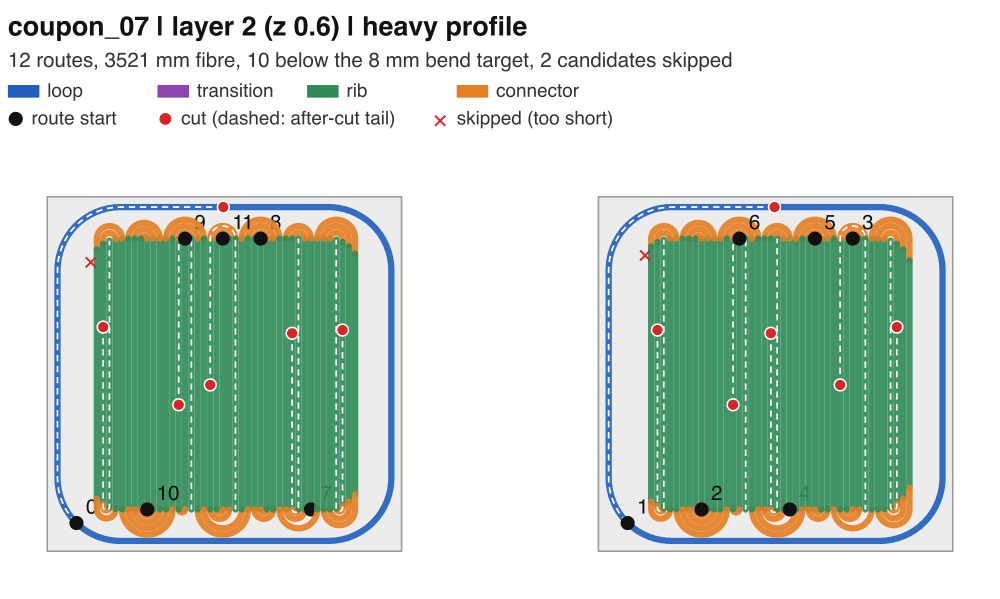

# FibreSeek route planner (clean-room) — specification

Status: implemented in `src/libslic3r/Fibreseek/` (namespace `Slic3r::Fibreseek`),
tested in `tests/libslic3r/test_fibreseek_route_planner.cpp`. Nothing in the slicing
pipeline calls it yet; a separate step will switch the call sites to it.

This planner decides **where continuous fibre goes on one layer**. It turns a layer's
region outlines into an ordered list of fibre *routes*. Each route is one continuous
strand: one load (`M1001`), one cut (`M2800`) and one finish (`M1002`). The planner
does not write G-code. The G-code writer turns routes into machine commands, and a small
adapter (`Fibreseek/WriterAdapter.hpp`) gives the writer route data in the field layout
it already reads.

It was designed only from the printer's G-code contract, the Tinman fibre settings, what
the writer needs, the machine's physics and published path-planning methods. The
provenance log at the end lists every source.

## 1. Inputs

`RoutePlanner::plan_layer(const LayerInput&)` plans one layer of one region.

| Field | Meaning |
|---|---|
| `layer_id`, `print_z`, `height` | Identify the layer. They are copied into the routes and diagnostics. |
| `slices` (`ExPolygons`, scaled) | The region's solid area on this layer: outer contours with holes. Separate islands are planned on their own, and routes never join islands. |
| `infill_candidates` (`Polylines`, optional) | Open paths supplied by the caller, used instead of generated ribs. These cover the *plastic traces* and *explicit* values of `fiber_infill_source_policy`. They are clipped and linked like ribs. |
| `fibre_layer_ordinal` | Index of this layer among fibre layers. It picks the rib angle and staggers the seams. |

`PlannerSettings` holds every tunable value. `settings_from_config()` fills it from a
`DynamicPrintConfig`, looking options up by key so that config-struct layout changes
don't break it:

| Setting | Option (default) | Use |
|---|---|---|
| fibre width `w` | `fiber_line_width` (0.8 mm) | Bead width, the spacing between concentric loops and the minimum clearance between fibre paths. |
| matrix width `w_m` | caller argument (0.45 mm) | Width of the plastic perimeters around the fibre. |
| plastic loops outside | `fiber_plastic_outer_loops_with_fiber` (2) | Plastic loops between the part surface and the first fibre loop. |
| plastic loops inside | `fiber_plastic_inner_loops_with_fiber` (0) | Plastic loops between fibre walls and fibre infill. |
| wall inset override | `fiber_perimeter_inset` (0 = derived) | Gap from the slice edge to the outer edge of the first fibre bead. |
| infill inset | `fiber_infill_inset` (0) | Extra clearance between walls (or holes) and infill ribs. |
| walls / infill | `fiber_generate_perimeters`, `fiber_generate_infill` | Turn each candidate family on or off. |
| outer / hole loops | `fiber_outer_perimeter_loops` (1), `fiber_inner_perimeter_loops` (1) | Number of concentric fibre loops along the outside and around each hole. |
| cut distance `L_cut` | `fiber_cut_distance` (required; 0 stops the slice) | Length of strand between the cutter and the nozzle tip. The writers cut when `L_cut` less `fiber_nozzle_contact_radius_extended` is left of the route, and size `M1001 L` with `L_cut`. |
| hardware minimum | `fiber_mechanical_min_route_length` (55 mm) | Hard floor: no route is ever shorter. |
| wall minimum | `fiber_perimeter_min_route_length` (55 mm) | Extra floor for wall routes. |
| user minimum | `fiber_min_route_length` (0 = planner default) | Extra floor for all routes. |
| bend radius target `r_t` | `fiber_min_radius` (8 mm) | Quality target for curvature (§3.3). |
| chord | `fiber_max_arc_segment_length` (1 mm) | Sampling step for generated arcs. |
| pattern / angles | `fiber_infill_pattern`, `fiber_infill_angles` | Rib direction for each fibre layer (§4.2). |
| spacing | `fiber_infill_spacing`, `fiber_infill_density`, `fiber_reinforcement_mode` | Rib spacing (§4.2). |
| seam | `fiber_seam_position`, `fiber_seam_angle` | Start points of closed routes (§4.1). |
| route cap | `fiber_max_routes_per_layer` (0 = none) | Keeps the N longest routes. |
| slow length | `fiber_slow_length` | Length of the `Start` phase label. |
| finish ironing | `fiber_finish_ironing_distance` | Length of the after-cut tail path the writer irons over. |
| nozzle contact radius | `fiber_nozzle_contact_radius` (0) | Infill spaces narrower than twice this are dropped. |

Planner constants. None of these is a setting yet; they are candidates, see §8:

| Constant | Value | Why |
|---|---|---|
| anchor length `a` | 7 mm | Strand that must be laid and stuck before the cutter may fire. With `L_cut` = 58 it gives the 65 mm standalone cut window that the contract recommends. |
| absolute turn floor `r_floor` | 0.5·`w` | Below this a turn is a kink, not a bend, so connectors never go tighter. |
| headland cap | 4·`w` | Most rib length given up at rib ends to make room for gentler turns. |
| extra spiral turns | 2 | Most loops added beyond the requested count to make a short feature long enough to cut. |
| closed-loop end gap | 0.5·`w` | Gap left where a single loop's end meets its start, so the strand never lands on itself. |

`schedule_from_config()` gives the layer schedule (§4.6), which says which layers get fibre.

## 2. Outputs

`LayerPlan`:

- `routes`: in emission order. Each `Route` has:
  - `pieces`: contiguous geometric pieces in mm. Each piece has a kind (`Loop`,
    `Transition`, `Rib`, `Connector`), a source candidate id, its length and its minimum
    radius. The end of each piece is the start of the next.
  - `kind`: `OuterWall`, `HoleWall` or `Infill`. `closed` is true for a single closed loop.
  - `length_mm`: the total fibre length, which is the whole path; every piece carries fibre.
  - `cut_at_mm` = `length_mm − L_cut`: where the cutter fires along the route.
  - `phases`: arc-length spans labelled `Start`, `Normal`, `SlowTurn` and `PostCutTail`
    (§3.2).
  - `tail`: an optional after-cut ironing path that starts exactly at the route end.
  - `min_radius_mm`, `warnings` and `candidate_ids`.
  - `void_crossings`: route samples whose bead would leave the part. It should be 0, and
    the route is not *release safe* otherwise.
- `fibre_footprint` (`ExPolygons`): the area the fibre beads cover. In fibre-owned
  ("composite only") mode the caller removes it from plastic infill, so plastic refills
  only what fibre doesn't cover.
- `diagnostics`: candidate counts, skipped candidates with a reason and length, and notes.

## 3. Physical constraints

### 3.1 Cut safety and minimum route length

The cutter sits `L_cut` upstream of the nozzle. When it fires, the last `L_cut` of
strand is already in the head. The head lays it by moving on with matrix only (the
writer's after-cut moves are V-only, with no U feed). The cut must therefore fire at
`length − L_cut`, and two things follow:

1. A route shorter than `L_cut` can't be cut inside itself, so its tail would overhang
   the path.
2. The cut must not fire before the strand is anchored, or the cut jerks a free strand.
   The planner needs at least `a` of laid fibre before the cut.

The minimum route length is therefore

```
L_min = max(hardware minimum, L_cut + a, user minimum)          (all routes)
L_min_wall = max(L_min, wall minimum)                            (wall routes)
```

With the Seeker 3 profile's 58 mm cut distance this is max(55, 58 + 7, 0) = **65 mm**. A shorter candidate is either
extended (§5) or skipped. A route is never emitted below the hardware minimum. The writer
puts `M1001 L` at ceil(length + `L_cut`) and places the cut itself, so the planner's
`PostCutTail` phase marks exactly the span the writer feeds after the cut.

### 3.2 Phases

The phases are labels for the writer and for diagnostics. The writer's speed changes
(slow start, after-cut speed) are keyed to arc length, so they line up with these spans:

- `Start`: [0, max(slow length, `a`)]. The strand is anchoring.
- `PostCutTail`: [`length − L_cut`, `length`]. The cut has fired and the strand is pulled,
  not pushed.
- `SlowTurn`: anywhere else whose local radius is below `r_t`.
- `Normal`: the rest.

Each curvature sample owns the bin between the midpoints to its neighbours, so the
labels tile the route with no gaps. Fragments are then merged: a `Normal` gap under 2 mm
between tight turns joins them, and a tight spot under 1 mm is dropped. Every phase span
becomes one writer segment. Without this merge, a gear-tooth route split into 920
segments, and the zero-length slivers made the audit's matrix-path total drift by 1 mm.

A tight turn inside `PostCutTail` gets its own warning (`tight_turn_in_post_cut_tail`).
There the strand is held only by adhesion, and a tight turn can drag its free end.

### 3.3 Bend radius

A strand in tension around a curve presses toward the curve's centre with a force of
roughly *T/R* per unit length. On tight curves it slides inward (corner cutting) or, if
the centre lies over a hole or the outside, off the edge. As the contract and the
setting's tooltip say, `fiber_min_radius` is a **quality target**: the planner aims for
it, and where the geometry can't allow it, it still plans the path and adds a
`below_min_bend_radius` warning. The audit reports those as advisories. Only turns
tighter than `r_floor` are refused, and only connectors (§3.5) can create such turns.

How radius is handled. Each level of wall loops (§4.1) is shaped in three steps:

1. **No sliver narrower than one bead.** An opening by `w/2` removes any strip narrower
   than `w`, since a loop around it would overlap itself. After this, every two loop
   boundaries on a level are at least `w` apart.
2. **Convex corners** (the centre of curvature lies over material) are **filleted
   locally** up to `r_t`. A fillet's tangent length is at most half of either
   neighbouring edge, so a narrow bar gets semicircular ends at the radius that fits.
   A fillet that would come within `w` of another loop on the same level is halved until
   it fits. Fillets only remove material at corners. A global morphological opening
   would also delete the strip between a hole and a nearby edge: the first version did
   this, and coupon 03 showed the edge loop wrapping around holes, which then lost their
   own loops.
3. **Narrow protrusions** the strand can't follow at the target radius, such as gear
   teeth and thin tabs, are removed by an opening of the **outer contour alone**,
   ignoring holes, after which the holes are subtracted again. The largest radius in
   `r_t`·{1, 0.7, 0.5, 0.35, 0.25} that keeps the piece's topology wins: still one piece,
   with the same holes and at least half its area. Holes take no part in this step. An
   opening of the whole piece pinches the necks between neighbouring holes into cusps,
   as an earlier version showed on the gear coupon.

- **Reflex corners and holes** (the centre lies over the outside or a hole) get the
  radius of the inset's round join. Small holes therefore get small radii and warnings.
  That trade is deliberate: a hole loop should hug its hole.
- **Measured radius.** The path is resampled at h = max(0.5 mm, chord/2). The radius at
  each sample is the circumradius of the samples **2 mm before and after it**. Near a
  path end the window slides inwards rather than shrinking. That averages curvature
  over about 4 mm, roughly the length over which the tow's stiffness acts, and stops the
  vertices of a polygonised arc reading as kinks: with neighbours only 0.5 mm away, an
  8 mm arc drawn as 0.8 mm chords reads as 5 mm. A radius counts as below target only
  under 0.95·`r_t`, because the chord sagitta makes arcs read up to about 4% tight. The
  route's `min_radius_mm` is the smallest value found.

### 3.4 Clearances

Fibre paths on one layer must never cross or overlap: the nozzle would plough through
fibre it has already laid. Every pair of fibre centrelines stays at least `w` apart,
checked with a tolerance of 0.95·`w`. Concentric loops are offset by exactly `w`. Ribs
keep at least `c = w + (plastic loops inside)·w_m + infill inset` from wall routes. Each
connector is checked against every other path.

### 3.5 Transitions inside a route

- **Spiral transition** (loop *k* to loop *k+1* of the same family): instead of closing
  loop *k*, the route moves sideways by `w` onto loop *k+1* over a length
  `T = max(2w, √(6·w·r_t))` (≈ 6.2 mm by default). The blend is
  `q(u) = a(u) + β(u)(proj(a(u)) − a(u))`, with `β = 3u² − 2u³`. Its peak curvature is
  6·w/T², so its radius is at least `r_t` on straight sections. Every loop is laid for
  its perimeter minus `T`, so a transition never overlaps the loop beside it. This is
  the usual way to turn concentric contour-parallel paths into a spiral (see the
  literature in §9).
- **Connectors** between infill ribs (or caller candidates) are **Dubins paths**: the
  shortest paths with a bounded turn radius between two positions with headings. They
  take one of the six forms LSL, RSR, LSR, RSL, RLR or LRL. The planner tries the turn
  radius `ρ_turn = max(s/2, min(r_t, 4w))` first, then a tight U-turn radius
  max(`r_floor`, lateral gap / 2). A connector must stay inside the fibre region without
  crossing its boundary and must keep the §3.4 clearance from every other path. The two
  ribs it links are exempt from that clearance check, since every turn starts and ends on
  them. Instead, the connector must not cross either rib or run alongside it: wherever it
  comes within `w` of a linked rib, its closest point on that rib must be the junction end
  itself. When more than one link works, the planner picks the lowest score: length plus
  2 mm × max(0, `r_t`/ρ − 1). It therefore prefers gentler turns whenever they fit.

## 4. Candidates and routing

### 4.1 Wall routes (spirals)

For each island and level *k* = 0, 1, …:

```
E_k = inset(island, d0 + k·w)        (round joins)
d0  = (fiber_perimeter_inset > 0 ? fiber_perimeter_inset : plastic_loops_outside·w_m) + w/2
```

The outer contours of `E_k`, after convex-corner opening (§3.3), are *outer-wall* loops,
used while *k* < outer loops. Its holes are *hole-wall* loops, used while *k* < hole loops.
Up to two further levels are kept in reserve for cut-window extension (§5).

Loops are linked into **families** by nesting. An outer loop at level *k+1* is the child
of the level-*k* loop that contains it. A hole loop at level *k+1* is the child of the one
level-*k* hole loop that it encloses. A family continues only while each parent has
exactly one child and each child exactly one parent. A split (a narrow neck) or a merge
(two holes whose bands meet) ends the family, and the pieces beyond start new families.

Each family becomes **one spiral route**: loop 0 from its seam, a transition, loop 1, and
so on. Every loop is traversed counter-clockwise. The seam goes on loop 0:

- `source`: the planner's default, the point with the smallest x + y.
- `nearest`: the point nearest the previous route's end.
- `aligned`: the point furthest in the `fiber_seam_angle` direction (0° = +X, counter-clockwise).
- `rear`: the point with the largest Y.
- `random`: a deterministic hash of the layer and loop.

The seam is then refined within ±10 mm. The planner picks the point whose transition
window [seam − T, seam] and anchor window [seam, seam + `a`] are straightest, with closeness to
the preferred point as the tie-break. Seams on tight curves weaken both the anchor and
the spiral step. A single closed loop stops `0.5·w` short of its start.

### 4.2 Infill ribs

Ribs are generated only where they fit:

```
F = inset(island, d0 [+ infill inset if no walls]) − dilate(wall routes, c)
    then opened by (nozzle contact radius − w/2) if that is > 0
R = inset(F, h),  with headland h = ρ_turn
```

There is **one direction per layer**: ribs that crossed on the same layer would stack
fibre on fibre. The direction is `angles[ordinal mod n]`. The angles come from
`fiber_infill_angles` (comma-separated degrees) or from the pattern defaults:

| Pattern | Angles (°) | Default spacing |
|---|---|---|
| solid | 0, 90 | `w` (fully dense) |
| rhombic | 45, 135 | by mode |
| isogrid | 0, 60, 120 | by mode |
| anisogrid | 30, 150, 90 | by mode |
| tetragrid | 0, 45, 90, 135 | by mode |

Spacing `s`: `fiber_infill_spacing` if above 0; otherwise `w / density` if
`fiber_infill_density` is above 0; otherwise the pattern default, or by mode: light
4·`w`, medium 2.5·`w`, heavy 1.5·`w`. Rib lines lie on a grid fixed to the bed origin.
Each time an angle comes round again in the cycle, its grid moves by `s/2`, so ribs at
the same angle on different layers sit between each other. Lines are clipped to `R`,
and pieces shorter than max(3 mm, 2·`w`) are dropped. Caller candidates take the place of
generated ribs and are clipped and filtered the same way.

**Linking (greedy chaining).** Ribs are nodes, and the two ends of each rib are ports.
1. Start a chain at the first unused rib in sweep order: lowest row, then lowest along-row
   coordinate.
2. From the chain's free end, try every unused rib with a port within
   `2·ρ_turn + 4·s + 2` mm, entered from either end, with a Dubins connector (§3.5). Ports
   are tried nearest first. A connector is never shorter than the straight line to its
   port, so the search stops once that distance exceeds the best score so far. Take the
   lowest-scoring valid one and repeat.
3. When the forward end is blocked, reverse the chain and grow it from the other end.
4. If the finished chain is shorter than `L_min`, it is skipped and plastic fills its area.

The same rule handles holes, odd outlines and separate islands. A link across a hole or a
gap would cross the region boundary, so it is never valid. Boustrophedon cell
decomposition would produce more regular orderings and is the obvious next step (§8).

### 4.3 Route order

Wall routes come first, then infill, each in nearest-neighbour order from the previous
route's end. The first route starts from the bed origin. Wall routes therefore mark the
boundaries before any infill is laid inside them.

### 4.4 Tail

When finish ironing is above 0, `tail` is a path from the route end of that length. A
single closed loop continues forward over its own start, pressing the joint. Any other
route runs back along its own last part. The writer irons only a tail that begins within
0.05 mm of the nozzle, and this one starts exactly at the route end.

### 4.5 Footprint

`fibre_footprint = union(offset(route paths, w/2))`.

### 4.6 Layer schedule

`fiber_start_layer` = S is a 1-based visible layer. Fibre may go on visible layers S to
N − S, so the same number of layers at the top stay fibre-free. S = 0 means "as early as
the planner allows": visible layer 2, with one fibre-free layer on top. Within that range
a layer gets fibre every `step` layers. `step` is `fiber_layer_step` if above 0, else
round(`fiber_macro_layer_height` / layer height) if above 0, else by mode: light 3,
medium 2, heavy 1.

## 5. Fallbacks when fibre cannot be placed

In order, for each candidate:

1. **Region too narrow.** If the inset for loop 0 is empty, there is no wall route there:
   `region_too_narrow`.
2. **Short wall family.** If the spiral is shorter than `L_min_wall`, extra levels are
   added (at most 2) while the family stays one-to-one, so a small hole's loop becomes a
   two- or three-turn spiral. That route is tagged `extended_turns_for_cut_window`. If it
   is still too short, it is skipped with `below_hardware_min_length` when under the
   hardware minimum, and with `below_cut_window` otherwise. The plastic walls stay, so the
   part is still complete.
3. **Bad spiral step.** If a transition's radius falls below `r_floor` (from a projection
   jump at a concave spot), the family is split there. Each part must reach `L_min` on its
   own.
4. **Short rib chain.** It is extended backwards, then skipped with a reason. Plastic
   refills its area.
5. **No gentle connector.** The planner tries the tight U-turn radius, and if that fails
   too it ends the chain.
6. **Route cap.** The longest routes are kept, and the rest are skipped with `route_cap`.
7. **Bad settings.** If a width or spacing is not above 0, the plan is empty and has the
   note `invalid_settings`.

A layer with no routes gets no fibre block from the writer.

## 6. Diagnostics

- Route warnings: `below_min_bend_radius`, `tight_turn_in_post_cut_tail`,
  `extended_turns_for_cut_window`, `spiral_split`.
- Skip reasons: `region_too_narrow`, `below_hardware_min_length`, `below_cut_window`,
  `route_cap`, `degenerate`. Each is counted, and `LayerDiagnostics::count()` gives the
  total for a reason.
- The two length reasons match the audit summary keys
  `routes_skipped_by_hardware_min_length` and `routes_skipped_by_cut_window_min_length`.
- Every route records its `candidate_ids`, so the loops and ribs it was built from can be
  traced.

## 7. Mapping onto the writer

The adapter `Fibreseek::to_writer_routes(plan, region_id)` returns `WriterLayerRoutes`.
Its field names and enum names match exactly what `GCode::extrude_fiberseek_composite_routes_for_layer()`
and the summary helpers in `GCode.cpp` read, so swapping planners is a type rename. A test
(`writer_contract_probe`) runs those exact expressions on the adapter output.

| Writer reads | Planner source |
|---|---|
| `routes`, `region_id` | `LayerPlan::routes`, caller's region index |
| `route.ordered_segments` (must be non-empty) | one polyline per piece |
| `route.planned_segments[i].polyline`, `.length_mm` | each piece split at phase boundaries |
| `.emits_fiber && .fiber_mm_per_mm > 0` | always true / 1.0, because every piece carries fibre |
| `.emits_plastic && .plastic_mm_per_mm > 0` | always true / 1.0, because fibre is always co-extruded with matrix |
| `.phase` (`Start`, `Normal`, `SlowTurn`, `PostCutTail`) | `Route::phases` |
| `route.is_release_safe()` | `void_crossings == 0 && length ≥ hardware minimum` |
| `route.layer_id`, `route.id` | layer id, route index |
| `route.shape` | `ClosedLoop` for a single loop, `NearClosedLoop` for a spiral, `OpenPath` for infill chains, `LineOrTail` for a single rib, `NoXYMotion` if empty |
| `route.length_mm`, `fiber_positive_length_mm` | `length_mm` |
| `route.matrix_positive_length_mm` | `length_mm` (the tail is ironing, not deposition) |
| `route.tail_segments`, `tail_length_mm` | `tail` |
| `route.warnings` | `warnings` |
| `route.candidate_ids` | `candidate_ids` |
| `route.coalesce_transition_length_mm` | spiral transition length `T` |
| `route.unsupported_void_crossing_count` | `void_crossings` |

How Tinman calls it (the swap, which removed the old planner):

- `PrintObject::plan_fibreseek_routes()` runs at the end of `PrintObject::infill()` in
  composite-only mode. For each fibre layer (`schedule_from_config`) and region it plans the
  region's slices, stores `to_writer_routes()` in `LayerRegion::fibreseek_routes`, and cuts
  the plastic fills (internal, solid, top, bottom and bridge infill) away under
  `fibre_footprint`. Layers are planned in parallel.
- `infill_candidates` stays empty, so infill always uses the planner's own ribs, whatever
  `fiber_infill_source_policy` says. Plastic traces would first need thinning to one fibre
  width apart.
- A change to any `fiber_*` setting in composite-only mode re-runs the infill step
  (`Print::apply`), so the routes and the trimmed infill always come from the same settings.
- The writer prints `route.warnings` comma-joined and `coalesce_threshold` = `T`. It has no
  path for routes without planned segments, since a release-safe route always has them.
- `fiber_cut_distance` and `fiber_restart_length` have no stand-in values: when they are 0
  the slice stops with an error naming the setting.

## 8. Not done yet, and candidate new settings

- Connections between short separate features (two small holes joined into one route
  by a connector) are not tried; such loops are extended into spirals or skipped.
- Rib linking is greedy. Boustrophedon cell decomposition with an optimal racetrack order
  would cut down skipped short chains on parts with many holes.
- There are no real test prints yet. Every number in §1's constants table needs checking
  on the printer.
- Candidate settings, which the PR lists without adding: anchor length (`a`), headland cap,
  extra spiral turns, closed-loop end gap, and the penalty weight for tight turns.

## 9. Validation

Commands, run on the build host (`build/arm64`, Release):

```
libslic3r_tests "[Fibreseek]"                                    # unit tests
FIBRESEEK_COUPON_DIR=<coupons> FIBRESEEK_COUPON_OUT=<out> \
FIBRESEEK_COUPON_PROFILE=medium|heavy libslic3r_tests "[fibreseek_coupons]"
python3 scripts/source-helpers/audit_fiberseek_gcode_contract.py <out>/<coupon>-<profile>.gcode
```

The coupon harness (`tests/libslic3r/test_fibreseek_route_coupons.cpp`) slices each coupon
STL from `scripts/generate_fiberseek_test_coupons.py` at 0.2 mm and plans every fibre
layer. It converts the plans with the writer adapter and emits G-code with the writer's
exact fibre command sequence: header summary, machine contract, initial plastic tool,
the per-layer tool change, `M1001` / restart / segments / the cut G-code at
`length − (58 − 1.8)` / V-only tail / `M1002`, the return to plastic, and shutdown. Plastic moves
are left out. It also writes the audit's summary JSON and an SVG of the first two fibre
layers. Results are in the PR.

Results (2026-11-14, mac-studio, Release build). In both profiles, all 14 coupon files
pass the contract audit, and no route bead leaves the part. "Below target" counts routes
with at least one turn under the 8 mm quality target. Every infill route with U-turns is
counted, since a 2 mm rib spacing can't turn at 8 mm.

| Coupon | Medium: fibre layers / routes / fibre mm | Heavy: fibre layers / routes / fibre mm | Spirals extended for the cut window (medium) |
|---|---|---|---|
| 01 rect plate | 14 / 68 / 24,259 | 28 / 301 / 104,849 | 0 |
| 02 single hole | 14 / 105 / 33,735 | 28 / 469 / 149,615 | 0 |
| 03 multi hole | 14 / 244 / 46,497 | 28 / 896 / 197,692 | 84 |
| 04 min-length bars | 12 / 48 / 6,209 | 23 / 92 / 11,901 | 0 |
| 05 bend-radius ladder | 14 / 212 / 54,218 | 28 / 784 / 243,326 | 14 |
| 06 gear, six holes | 17 / 236 / 28,422 | 33 / 696 / 89,328 | 119 |
| 07 separate islands | 12 / 84 / 19,636 | 23 / 276 / 80,522 | 0 |

The medium profile uses rhombic ribs at 2 mm, fibre every second layer, and 5 mm finish
ironing. The heavy profile uses solid ribs at 0.8 mm and fibre on every layer. Planning
took 0.17 s per fibre layer (medium) and 0.19 s (heavy), single-threaded. Layers are
independent, so a caller can plan them in parallel.

| | |
|---|---|
|  |  |
| Coupon 03: the edge loop hugs the edge; every hole gets a two-turn spiral (purple steps) because one loop is under 65 mm; rhombic ribs linked by U-turns. | Coupon 06: the outer loop follows the tooth roots; teeth are too narrow for an 8 mm bend and stay plastic; six hole spirals and a centre spiral. |
|  |  |
| Coupon 05: 12 mm hole spiral, 20 mm hole loop. The 28 and 36 mm holes overlap in the coupon and sit 2 mm from the edge, too thin for fibre, so the edge loop goes around them. | Coupon 04: each bar gets one closed loop; even the 40 mm bar's loop (about 84 mm) clears the 65 mm cut window. The bars are too narrow for ribs. |
|  |  |
| Coupon 01, heavy: solid 0.8 mm ribs linked by nested racetrack turns. | Coupon 07, heavy, layer 2 (90°): each island is planned on its own and no route crosses the gap. |

Dashed white: the after-cut tail (the last 58 mm, laid by pulling). Red dot: where the
cutter fires. Red ×: a candidate skipped as too short.

## 10. Provenance log

Clean-room rules: this module was written without reading, opening, grepping or diffing
the existing `FiberseekCompositePlanner.*`, its tests, its prototype script, its
history (commit `7ad1c8e08a` and later), `docs/research/*fiberseek*`, the private
TinManX1 research branches, the ChatGPT *Tinman X1/outputs* folder, the Codex checkout's
uncommitted files, or anything from Rocket Slicer: the app, its G-code, its presets or
comparison data.

Sources used:

| Source | What was taken |
|---|---|
| `docs/fiberseek-gcode-contract.md` | Command order for each route, tool ownership, the 55 / 58 / 54.8 mm cut numbers, the 65 mm standalone cut window, bend radius as an advisory target, the seam modes and the light / medium / heavy modes. |
| `src/libslic3r/PrintConfig.cpp` / `.hpp`, option definitions and enums only | Names, defaults and tooltips of every `fiber_*` / `continuous_fiber_*` option in §1, and the enums for mode, pattern, source policy and seam. |
| `src/libslic3r/GCode.cpp`: `extrude_fiberseek_composite_routes_for_layer()`, the route summary helpers, start/contract/shutdown helpers | Which route fields the writer reads and what they mean (§7), how it places the cut, the after-cut V-only moves, the tail-ironing rule (0.05 mm), and the output sequence that the test harness copies. These parts of the writer were listed as independent in the 2026-11-05 provenance review. |
| `src/libslic3r/GCodeWriter.cpp` / `.hpp` | Checked; they contain no FibreSeek-specific code. |
| `src/libslic3r/Layer.hpp`, two lines seen in a grep result | That `LayerRegion` holds a member `fiberseek_composite_diagnostic` and a `has_fiberseek_composite_routes()` helper. The old planner's header was not opened. |
| `scripts/source-helpers/audit_fiberseek_gcode_contract.py` | What it checks (order, counts, `M1001` load, V-only tail, summary keys), used to validate the harness output. The `--require-alternation` warning names belong to the old planner and are not used. |
| `scripts/generate_fiberseek_test_coupons.py` | The seven coupon geometries, run unchanged to make the test STLs. |
| FibreSeeker 3 public material ([SimplyPrint compatibility page](https://simplyprint.io/compatibility/fibreseek-fibreseeker-3), [3D Printing Industry launch article](https://3dprintingindustry.com/news/industrial-composite-strength-now-fits-on-your-desk-with-fibreseeker-3-for-2699-244122/)) | The machine co-extrudes composite fibre (CFC) beside a plain FFF nozzle, and minimum fibre length and seam placement are real constraints. No numbers were taken. |
| General Tinman/Orca libraries (`ClipperUtils`, `SVG`, `TriangleMeshSlicer`, `ExPolygon`) | Offsets, clipping, slicing and SVG output. |
| Published methods | L. E. Dubins (1957), *On curves of minimal length with a constraint on average curvature*, Amer. J. Math. 79; A. M. Shkel and V. Lumelsky (2001), *Classification of the Dubins set*, Robotics and Autonomous Systems 34; S. M. LaValle (2006), *Planning Algorithms*, §15.3 (Dubins words and their closed forms). H. Choset (2000), *Coverage of known spaces: the boustrophedon cellular decomposition*, Autonomous Robots 9; D. Bochtis and S. Vougioukas (2008), work on headland turning and row skipping in field coverage. M. Held and C. Spielberger (2009), *A smooth spiral tool path for high speed machining of 2D pockets*, CAD 41 (contour-parallel to spiral paths). Morphological opening and closing (J. Serra, *Image Analysis and Mathematical Morphology*, 1982) for corner rounding. |

Files opened during this work that turned out to contain derived material: **none**.

One incident, recorded for completeness: while checking which processes on the shared
build host were mine, a `pgrep` listing showed another session's test run of the old
planner's suite. Its command line contained one test-case name, about returning isolated
non-cut-safe candidates as a plastic fallback. Nothing else from that suite was seen. The
plastic fallback (§5) was already in this spec before then, and nothing was changed
because of it.

Credits: the planner was written by Claude (Anthropic), working for Tinman's maintainer.
It builds on OrcaSlicer's and PrusaSlicer's geometry libraries, on ClipperLib by Angus
Johnson, and on the published work above.
